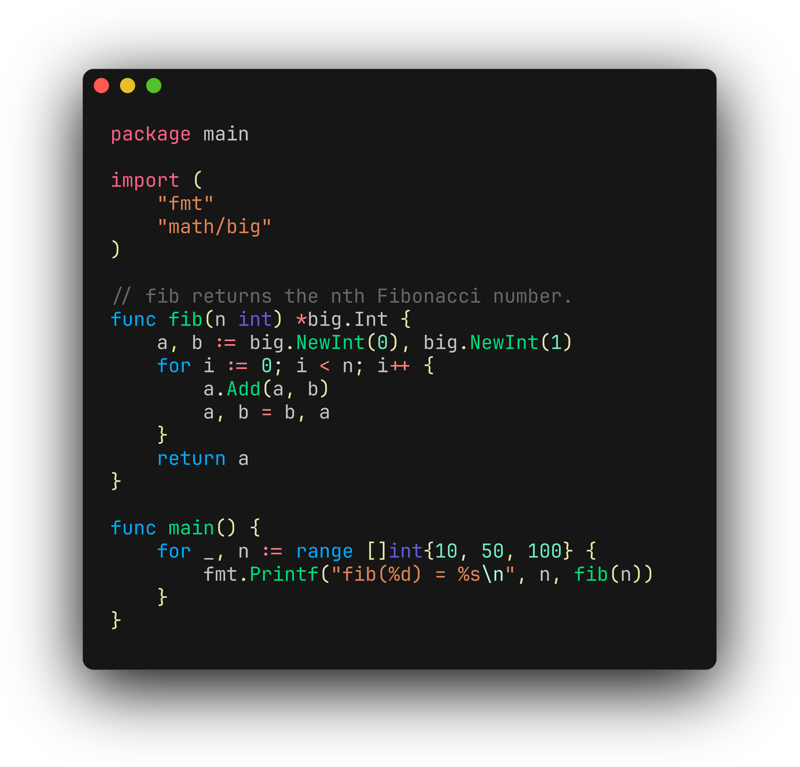
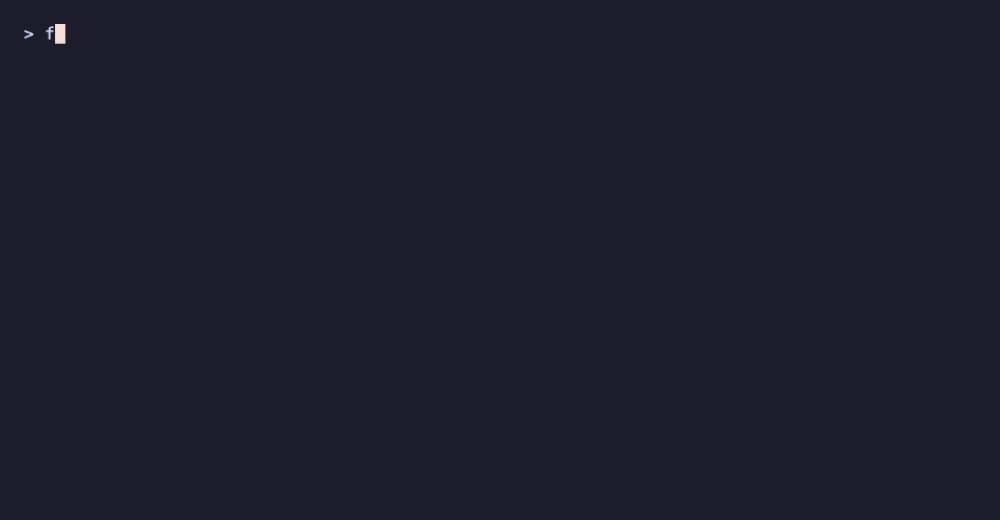
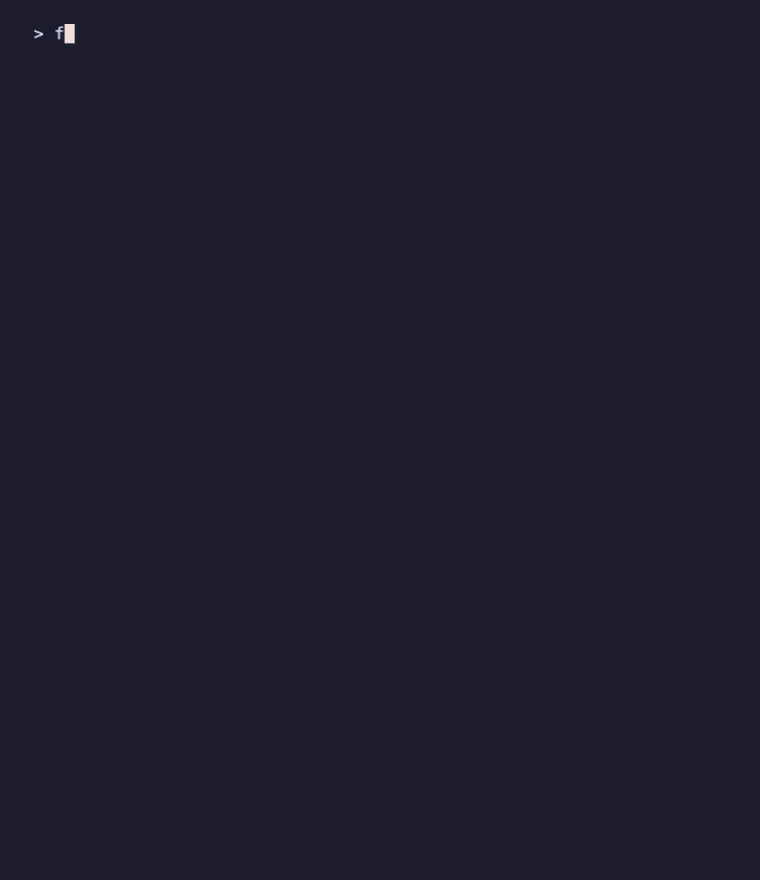
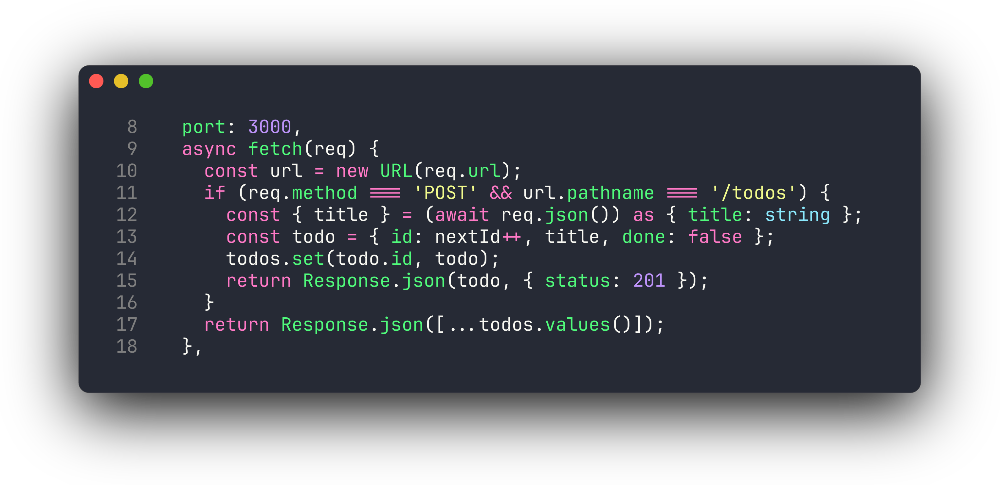
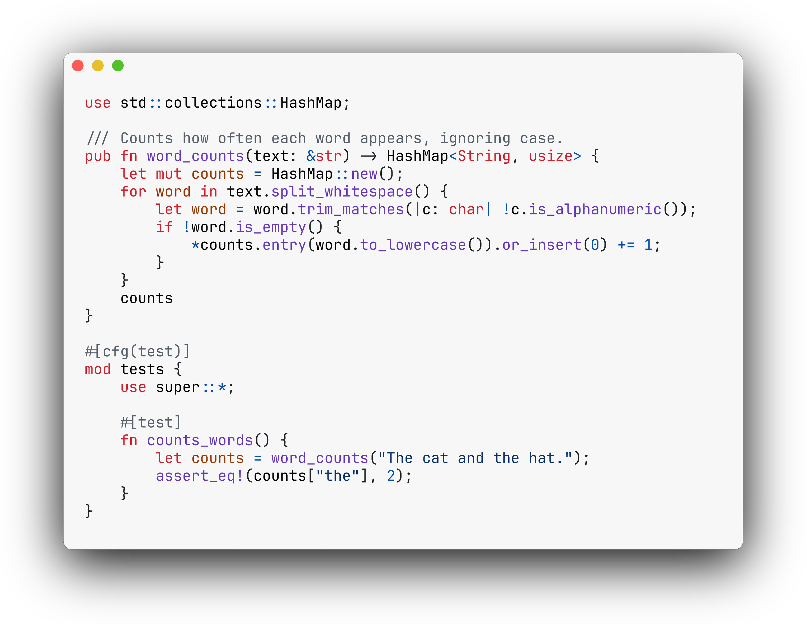
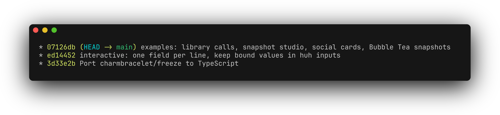
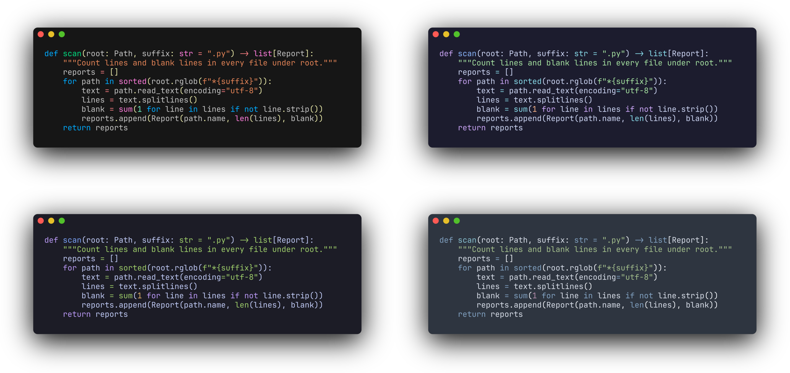
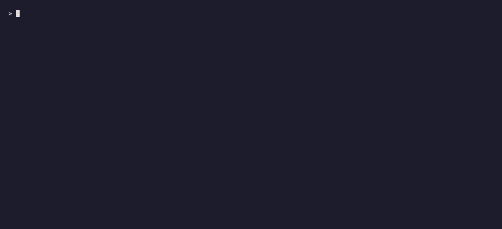
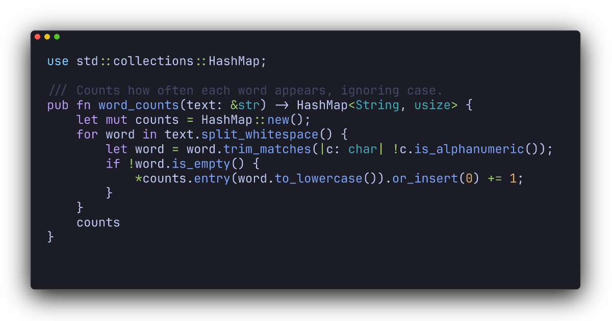
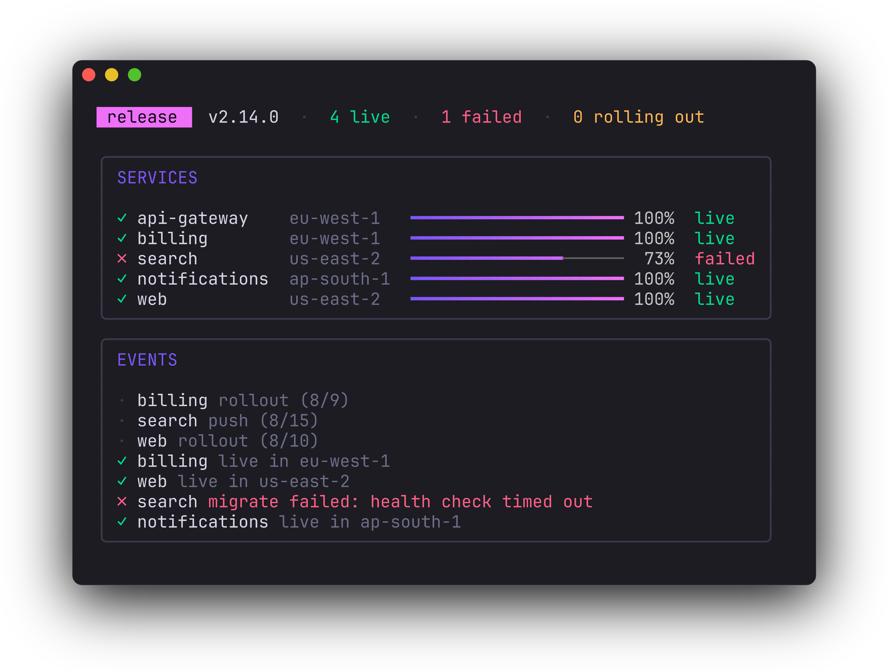

# @oakoliver/freeze

Generate images of code and terminal output: SVG, PNG and WebP. A TypeScript port of [charmbracelet/freeze](https://github.com/charmbracelet/freeze) with the same `freeze` command and a library API. Version 1.0.0 targets **freeze v0.2.2** plus `main` up to [`65acb1e`](https://github.com/charmbracelet/freeze/commit/65acb1e) (the `--execute` fixes since the release). See [CHANGELOG.md](CHANGELOG.md).



**Read the article:** [Getting Started with Freeze in TypeScript](https://engineering.oakoliver.com/articles/getting-started-freeze-code-screenshots-svg-png-typescript) · [Porting Freeze from Go to TypeScript](https://engineering.oakoliver.com/articles/porting-go-freeze-to-typescript-code-and-terminal-screenshots)



## Features

- **Code to image**: syntax highlighting with all 74 of chroma's themes (plus freeze's `charm`), languages detected from the file name or content by chroma's own rules
- **Terminal output to image**: `--execute` runs a command in a pseudo-terminal and keeps its colours, backgrounds, italics, underline and strikethrough
- **Window chrome**: window controls, rounded borders, outline, drop shadow, padding and margins in CSS order, fixed or automatic size
- **Line ranges and line numbers**, wrapping (`--wrap`), font family, size and line height, ligatures on or off
- **SVG with the font embedded** (JetBrains Mono, OFL), so it looks the same in every browser and viewer
- **PNG and WebP** through [resvg](https://github.com/RazrFalcon/resvg), drawn at 4x when the size is automatic; WebP is encoded by a small lossless encoder written in TypeScript
- **Presets**: `base`, `full`, your own JSON file, and `user` (saved by the interactive mode)
- **Interactive mode** (`--interactive`) built with [@oakoliver/huh](https://github.com/oakoliver/huh)
- **A library API**: `renderSVG`, `renderPNG`, `renderWebP`, `freeze`, `freezeCommand`, non-blocking `renderPNGAsync`, `renderWebPAsync` and `freezeAsync`, plus the pieces (`executeCommand`, `tokenise`, `getStyle`, `encodeWebP`, ...)
- Node.js 18+ and Bun; ESM and CommonJS builds with type declarations

## Install

```bash
npm install @oakoliver/freeze          # library + CLI in node_modules/.bin
npm install -g @oakoliver/freeze       # the freeze command on your PATH
```

PNG and WebP use the optional dependency [`@resvg/resvg-js`](https://github.com/yisibl/resvg-js) (prebuilt binaries, installed automatically where available). SVG needs no native code at all. Without resvg-js, PNG falls back to `rsvg-convert` if it is on your PATH; otherwise `freeze` says what to install:

```
  ERROR  Unable to convert SVG to PNG
  PNG and WebP output need the optional dependency @resvg/resvg-js. Install it with `npm install @resvg/resvg-js` (or `bun add @resvg/resvg-js`), or write an .svg instead.
```

## CLI

```bash
freeze main.go                                  # freeze.png with the base preset (4x)
freeze main.go -o code.svg                      # SVG instead
freeze main.go -c full                          # window, border and shadow
freeze main.go -t dracula --lines 10,24 --show-line-numbers -o part.png
freeze -x "eza -la --color=always" -o ls.webp   # a command's output
cat main.go | freeze -l go -o stdin.svg         # stdin
freeze -i main.go                               # interactive
```

The flags are upstream's (`freeze --help` prints them): `--background`, `--margin`, `--padding`, `--window`, `--width`, `--height`, `--config`, `--language`, `--theme`, `--wrap`, `--output`, `--execute`, `--execute.timeout`, `--border.radius`, `--border.width`, `--border.color`, `--shadow.blur`, `--shadow.x`, `--shadow.y`, `--font.family`, `--font.file`, `--font.size`, `--font.ligatures` / `--no-font.ligatures`, `--line-height`, `--lines` and `--show-line-numbers`. Margins and paddings take one, two or four comma-separated values.

### Interactive mode



The choices are saved to `user.json` in your configuration directory (`$XDG_CONFIG_HOME/freeze`, `~/Library/Application Support/freeze` on macOS) and reused with `--config user`.

## Library

```typescript
import { renderSVG, renderPNG, freeze, freezeCommand, encode } from '@oakoliver/freeze';
import { writeFileSync } from 'node:fs';

// A file, the full preset, a theme.
writeFileSync('main.svg', renderSVG({ file: 'main.go', config: 'full', theme: 'catppuccin-mocha' }));

// A string, a line range, line numbers, PNG bytes.
const png = renderPNG({ code: source, language: 'typescript', lines: [3, 12], showLineNumbers: true });

// Like the CLI: format from the extension, file written for you.
freeze({ file: 'main.go', output: 'main.webp', border: { radius: 12 } });

// A command's coloured output.
const rendered = await freezeCommand('git --no-pager log --oneline --color=always -10', { config: 'full', format: 'png' });
writeFileSync('log.png', encode(rendered, 'png'));
```

### Servers: the async API

`renderPNG`, `renderWebP` and `freeze` are synchronous: resvg draws on the calling thread, which at the automatic 4x scale takes about a second for a 120x34 terminal frame and stalls everything else in the process. In a server use the async variants. They return a promise and the byte-identical output, while resvg renders on a worker thread (and the `rsvg-convert` fallback is spawned asynchronously).

```typescript
import { renderPNGAsync, renderWebPAsync, freezeAsync } from '@oakoliver/freeze';

const png = await renderPNGAsync({ code: frame, language: 'ansi', config: 'full' });
const webp = await renderWebPAsync({ file: 'main.go' });
await freezeAsync({ file: 'main.go', output: 'main.png' });
```

Also exported: `encodeAsync`, `svgToPNGAsync`, `svgToWebPAsync` and `rasterizeAsync`. Several renders in flight run in parallel on libuv's thread pool (four threads by default; see `UV_THREADPOOL_SIZE`). The CLI uses the async path.

What still runs on the main thread: laying out the SVG (tens of milliseconds) and the encoding of the finished pixels, resvg's PNG encoder (about 150 ms at 4x for a 4753x3032 frame) and the WebP encoder (about 150 to 300 ms at 4x, plain JavaScript). That is a short pause instead of a second or more, but not zero. Auto-sized output is 4x; set `width` and `height` to draw at 1x, where everything takes a few milliseconds.

Every option of the CLI is a field of `FreezeOptions` (`window`, `padding`, `margin`, `border`, `shadow`, `font`, `lineHeight`, `lines`, `wrap`, `width`, `height`, `background`, `theme`, `language`, `config`). `render()` returns the SVG together with its size, the scale and the detected language. The lower-level parts are exported too: `executeCommand` (run a command in a terminal), `tokenise` and `getLexer` (highlighting), `getStyle`, `styleNames` and `registerStyle` (themes), `svgToPNG`, `svgToWebP`, `rasterize` and `encodeWebP`.

## Examples

The images in this README are real output, made by the programs in [`examples/`](examples/) and the CLI; the recordings are made with [@oakoliver/vhs](https://github.com/oakoliver/vhs) from the tapes in [`assets/tapes/`](assets/tapes/).

| | |
|---|---|
|  |  |
| `freeze server.ts -c full -t dracula --lines 8,18 --show-line-numbers` | `freeze lib.rs -c full -t github -o rust-github.webp` |
|  |  |
| `freeze -x "git --no-pager log --graph --color=always -8" -c full` | four of the 75 themes |

Small programs:

```bash
bun examples/code-to-svg.ts examples/samples/fib.go fib.svg     # renderSVG, the full preset
bun examples/snippet.ts examples/samples/fib.go 8 16 dracula    # a line range, a theme, PNG
bun examples/command-output.ts "ls -la"                         # freezeCommand + encode
```

### studio.ts: a snapshot studio



A full-screen [Bubble Tea](https://github.com/oakoliver/bubbletea) program: browse a directory's source files, preview the highlighted code in the terminal with the theme, window, line numbers, shadow and line range you pick, see the image's pixel size update live, and export SVG, PNG or WebP. The preview uses the same tokens and theme colours as the image.

### social-cards.ts: README and social images in one go



A list of samples, themes and sizes in, a folder of images and a `manifest.json` out: Open Graph cards at exactly 1200×630, a 1080×1080 square, and auto-sized README images at 4x. It picks the lines that fit a fixed-size card. Seven images take about 0.85 s.

### tea-snapshot.ts: freeze a Bubble Tea program



A Bubble Tea view is a string with ANSI styling, so freeze can turn any frame into an image. Run it and press `s` to save the screen as SVG, or run `--headless` to step the model without a terminal and write frames (this image is one of them).

Keys, flags and details for each one are in [`examples/README.md`](examples/README.md).

## Dependencies

| Package | Kind | Why |
|---|---|---|
| `@oakoliver/lipgloss` | dependency | ANSI tokenizer and cell widths for terminal output, the CLI's banners and help |
| `@oakoliver/huh` | dependency | the `--interactive` form (brings `@oakoliver/bubbletea` and `@oakoliver/bubbles`) |
| `highlight.js` | dependency | syntax highlighting, the same approach as [@oakoliver/glamour](https://github.com/oakoliver/glamour) |
| `@resvg/resvg-js` | optional | PNG and WebP rasterizing |

The sibling ports are regular dependencies, not peer dependencies: freeze's API takes and returns strings and bytes, so none of their types or instances cross the boundary between your code and freeze, and there is nothing for your app and freeze to share. (Bubble Tea views are plain strings; `tea-snapshot.ts` passes one in.) The examples use `@oakoliver/bubbletea` and `@oakoliver/bubbles` directly, which is why they are dev dependencies here.

## Parity with freeze v0.2.2

The test suite ports upstream's tests (`cut_test.go`, `config_test.go` and `freeze_test.go`, including all 29 golden SVGs of `TestFreezeConfigurations`) to `bun test` and runs the CLI the way upstream runs its binary.

- **Terminal output is byte-for-byte identical.** The five ANSI goldens (`eza`, `layout`, `helix`, `glow`, and `execute`, which really runs `echo "Hello, world!"` through a terminal) match upstream's SVG exactly, apart from the font declaration below. So do eight more cases rendered by the Go binary for this port (`tests/golden/extra`): line numbers, `--wrap` and `--lines` on terminal output, a fixed size, font size, line height and family, margins, and an `--execute` of 256-colour, bold, italic and tab sequences.
- **Code images match in everything but token colours.** For the 24 code goldens, the document skeleton (image and window size, every text position, padding, margins, window controls, border, shadow, clip path, line numbers, line ranges, wrapping, overflow and the text of every line) is byte-for-byte identical. Colours are where they differ: upstream lexes with chroma, this port with highlight.js mapped onto chroma's token types (as Glamour does), so 93.1% of characters get the same colour on average across those goldens (95.6% for the Haskell sample, 99.6% for the Bubble Tea Go sample, 67.8% for a large YAML file).
- **Themes are chroma's.** The 74 chroma styles and freeze's `charm` style are generated from chroma v2.24.1 (`scripts/gen-chroma`), with chroma's inheritance and `Sub` rules, so a theme name gives the same colours as in Go.
- **Languages are detected the same way.** chroma's lexer registry (names, aliases, file name globs, priorities and the content analysers used for stdin) is generated too, so the same files are recognised, and the same ones give `Language Unknown`. A chroma language highlight.js does not know renders as plain text.
- **The same font files**, byte for byte (JetBrains Mono 2.305 and JetBrains Mono NL 2.304).

Differences, all deliberate:

- **The embedded font is declared as what it is.** Upstream embeds TrueType data labelled `application/x-font-woff2` / `format('woff2')`, followed by a stray `'`. This port writes `font/ttf` / `format('truetype')` and no stray quote. Browsers sniff the format either way; strict validators and converters do not.
- **WebP works.** Upstream lists `.webp` but writes SVG text into the file. This port encodes lossless WebP (and draws it at 4x like PNG).
- **PNG prefers resvg.** Upstream tries `rsvg-convert` first; that path ignores the embedded font and draws with whatever system font matches, so on a machine without JetBrains Mono installed upstream's PNG comes out in a proportional font. This port uses resvg with the bundled font loaded (as upstream's fallback does) and uses `rsvg-convert` only when resvg-js is missing.
- **`--no-font.ligatures` also works in PNG and WebP.** resvg picks fonts by family name and the no-ligature file is called "JetBrains Mono NL", so upstream's PNGs keep `=>` and `!=` ligatures even with ligatures off. This port rasterizes with the NL family in that case (the SVG is unchanged).
- **`--execute` without a native PTY.** Upstream uses a PTY library; this port uses Bun's built-in terminal under Bun, `script(1)` under Node.js on macOS and Linux, and pipes with `FORCE_COLOR`/`CLICOLOR_FORCE` elsewhere (Windows). The timeout kills with SIGKILL, as `exec.CommandContext` does.
- **Interactive mode keeps one field per line.** Upstream sets an empty field separator, which with huh v1 runs the fields together on one line and hides most of them (current upstream `main` renders the form that way). This port uses a single newline, which gives the layout of upstream's own recording. It also refuses to start without a terminal instead of waiting on input that never comes.
- **Help output** strips colours when stdout is not a terminal, including the stray `ESC[38;5;243m` upstream leaves after highlighted words.
- **Error messages** for unusual flag values follow kong's wording only approximately.

Kept as upstream does it (they are visible in the output, so changing them would break parity): token background rectangles are not offset by padding; on ANSI input with `--show-line-numbers` the text before the first colour change takes the line-number colour; a tab at the start of an ANSI line prints nothing; SGR 100-107 backgrounds have no colour; bold is ignored.

## Fonts

`fonts/` holds unmodified copies of JetBrains Mono Regular and JetBrains Mono NL Regular, © 2020 The JetBrains Mono Project Authors, under the [SIL Open Font License 1.1](fonts/OFL.txt). They ship with the package, are embedded in SVG output so the image renders the same everywhere, and are loaded into resvg for PNG and WebP. The OFL lets fonts be embedded in documents, and documents made with the font are not covered by it. Pass `--font.family` to use another family (not embedded), or `--font.file` to embed your own `.ttf`, `.woff` or `.woff2`.

## Development

```bash
bun install
bun test                     # 100 tests: upstream's tests and goldens, extra goldens, unit tests
npm run build                # dist/: ESM, CommonJS, CLI and type declarations
(cd scripts/gen-chroma && go run .) > src/chroma-data.ts          # chroma styles
(cd scripts/gen-chroma && go run . lexers) > src/lexers-data.ts  # chroma lexer registry
```

## Attribution

This is a TypeScript port of [freeze](https://github.com/charmbracelet/freeze) by [Charmbracelet, Inc.](https://charm.sh), licensed under MIT. Themes and the lexer registry are generated from [chroma](https://github.com/alecthomas/chroma) (MIT). Fonts: JetBrains Mono (OFL 1.1).

## License

MIT
